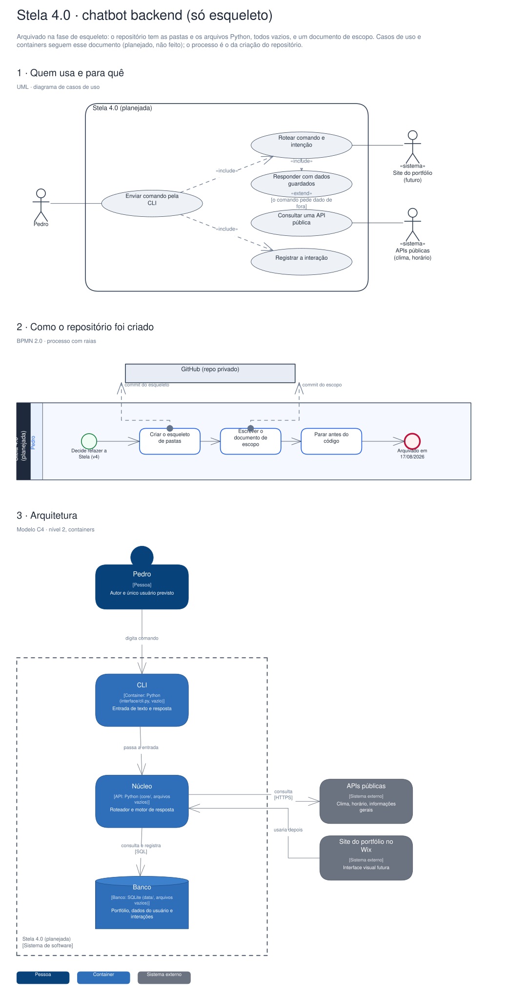

# Arquitetura

Diagramas gerados a partir do Sinapse (o segundo cérebro do Pedro). Cada projeto tem três vistas,
cada uma numa notação padrão:

1. **Quem usa e para quê**: UML, diagrama de casos de uso.
2. **O processo principal**: BPMN 2.0, com raias por quem executa.
3. **A arquitetura**: modelo C4, nível 2 (containers).

## Stela 4.0 · chatbot backend (só esqueleto)

Arquivado na fase de esqueleto: o repositório tem as pastas e os arquivos Python, todos vazios, e um documento de escopo. Casos de uso e containers seguem esse documento (planejado, não feito); o processo é o da criação do repositório.

Editável: [`stela.excalidraw`](./stela.excalidraw), abre em [excalidraw.com](https://excalidraw.com) ou no VS Code com a extensão Excalidraw.

A fonte destes arquivos é o vault do Sinapse (`09-DESENHOS/`); alterações feitas aqui são sobrescritas na próxima publicação.
